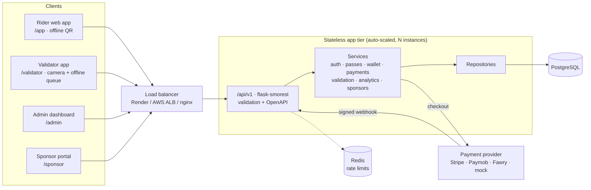

# CloudBus Pass

**Bus passes on your phone — no queues, no paper, no fraud.**
A cloud-hosted ticketing platform for riders, bus conductors, operators and university/company sponsors.
Built for CodeAlpha Cloud Computing (Task 3: Cloud-Based Bus Pass System) and grown into an investor-ready product.

- **Riders** buy daily / weekly / monthly / semester passes or pay per ride from a wallet, show a rotating QR code
  that works offline, track buses live, and get student/senior discounts — in English or Arabic (full RTL), light or dark.
- **Conductors** scan with the phone camera and see VALID / EXPIRED / FRAUD instantly, even without internet.
- **Operators** manage routes, stops, buses, fares and discounts, issue refunds, and watch revenue, rides and fraud live.
- **Universities & companies** buy seats in bulk and share one invite code with their members.

Business model, pricing, KPIs and user stories: [docs/BUSINESS_MODEL.md](docs/BUSINESS_MODEL.md) ·
Audit of the v0.1 prototype: [docs/AUDIT.md](docs/AUDIT.md) · Roadmap: [docs/ROADMAP.md](docs/ROADMAP.md)

## Demo accounts

All demo accounts use the password **`Demo@12345`** (seeded by `flask init-db` / `flask seed` in demo mode).

| Role | Login | Open |
|---|---|---|
| Rider (monthly pass, 250 EGP wallet) | `rider@cloudbus.test` | `/app` |
| Student (approved 40% discount, semester pass) | `student@cu.test` | `/app` |
| Senior (discount pending review) | `senior@cloudbus.test` | `/app` |
| Conductor / validator | `validator@cloudbus.test` | `/validator` |
| Operator admin | `admin@cloudbus.test` | `/admin` |
| University sponsor (Cairo University) | `sponsor@cu.test` | `/sponsor` |

Promo codes: `WELCOME20` (−20%), `CAMPUS50` (−50 EGP), `SUMMER10` (expired). Sponsor invite code: `CUFALL26`
(only for `@cu.test` emails). In demo mode the one-time login code is shown on screen and card payments go through
a local test checkout.

## Architecture



```
buspass/
  api/v1/        HTTP layer: auth, rider (me, catalog, passes), operations (payments, validator, sponsor, admin), schemas
  services/      business logic: auth, pricing, passes, wallet, qr, validation, payments, catalog, sponsors, accounts, analytics, admin, audit, notify
  payments/      provider interface + mock, Stripe, Paymob, Fawry adapters
  repositories.py  all database queries        models.py  SQLAlchemy schema
  config.py · security.py · errors.py · logging_setup.py · cli.py · seed.py · web.py
migrations/      Alembic migrations          templates/ · static/   landing page + 4 web apps (vanilla JS, no build step)
tests/           unit (services), integration (API), e2e (Playwright browser)
docs/            audit, roadmap, business model
```

### How the hard problems are solved

| Problem | Solution |
|---|---|
| **Screenshot / shared passes** | QR = `CB1.<kind>.<id>.<30-second window>.<HMAC-SHA256>`. The phone computes it with a per-pass secret (Web Crypto), so it changes every 30 s and works offline. The server rejects codes older than ~1 minute, codes older than the last accepted one (replay), and the same pass on a different bus within 10 minutes (anti-passback). |
| **Lost / stolen phone** | Passes live in the account. "Block old codes" rotates the per-pass and wallet secrets, so the old device's codes stop working at once. |
| **Wrong pricing** | Prices come only from the server's fare table (integer piastres): base × pass multiplier → student/senior discount → promo code. Unknown fields such as `price_cents` are rejected by validation. |
| **Double charges** | Every purchase and checkout carries an idempotency key (unique per user). Webhooks are processed exactly once per `(provider, event_id)`, and the amount must match. |
| **Overselling single tickets** | Row lock on the route while checking daily capacity. |
| **High traffic** | Stateless instances (JWT, no server sessions) behind a load balancer; migrations run under a PostgreSQL advisory lock so many instances can boot at once; Redis-backed rate limits; health checks for auto-scaling. |
| **No signal on the bus** | Rider app shell cached by a service worker + pass secrets cached on the device; validator queues scans with their real scan time and syncs them idempotently. |

## Run it

### Locally (SQLite, no Docker)
```bash
pip install -r requirements.txt
```
```bash
flask --app wsgi init-db
```
```bash
flask --app wsgi run
```
Open http://127.0.0.1:5000 (landing page), `/app`, `/validator`, `/admin`, `/sponsor`, and the API docs at
http://127.0.0.1:5000/api/v1/docs.

### Docker (PostgreSQL + Redis + 3 app servers behind nginx)
```bash
docker compose up --build
```
Open http://localhost:8080. Scale while it runs: `docker compose up -d --scale app=5`.
`/healthz` shows which container answered.

### Deploy to Render (free)
Push to GitHub → Render → **New → Blueprint** → pick the repo → **Apply**. `render.yaml` creates the PostgreSQL
database and the web service, generates the secrets, and runs in demo mode.

### Deploy to AWS Elastic Beanstalk (auto-scaling 2–8 instances)
```bash
eb init -p docker cloudbus-pass
```
```bash
eb create cloudbus-prod --database.engine postgres
```
Then `eb setenv APP_ENV=production SECRET_KEY=... DATABASE_URL=... COOKIE_SECURE=1` (see `.env.example`).
`.ebextensions/01-autoscaling.config` adds/removes instances on CPU load with `/healthz` health checks.

### Scheduled job
Run `flask --app wsgi daily-jobs` once a day (e.g. 00:05 Cairo time — a Render Cron Job, EventBridge, or cron).
It auto-renews passes from the wallet, expires old passes, and sends "expires today" reminders.

## Scripts

| Command | What it does |
|---|---|
| `flask --app wsgi init-db` | Run migrations; seed demo data if the DB is empty and `DEMO_MODE=1` |
| `flask --app wsgi seed --reset` | Recreate the demo data (refuses in production) |
| `flask --app wsgi daily-jobs` | Renewals, expiry, reminders |
| `flask --app wsgi db migrate -m "..."` / `db upgrade` | Create / apply a migration after changing models |
| `python -m pytest` | Unit + integration tests (and browser E2E when Playwright is installed) |
| `python -m ruff check . && python -m ruff format --check .` | Lint + format check |
| `locust -f locustfile.py --host http://localhost:8080` | Load test |

Dev tools: `pip install -r requirements-dev.txt && python -m playwright install chromium`.

## Configuration

All settings are environment variables — see [.env.example](.env.example).

| Variable | Default | Notes |
|---|---|---|
| `APP_ENV` | `development` | `production` refuses to start with development secrets |
| `SECRET_KEY` | dev value | Signs OTP hashes; also the JWT key if `JWT_SECRET` is unset |
| `JWT_SECRET` | `SECRET_KEY` | Access/refresh token signing |
| `DATABASE_URL` | `sqlite:///buspass.db` | PostgreSQL in the cloud |
| `DEMO_MODE` | on outside production | OTP shown on screen, demo seed, test checkout |
| `PAYMENT_PROVIDER` | `mock` | `stripe` (test keys), `paymob`, `fawry` |
| `STRIPE_SECRET_KEY` / `STRIPE_WEBHOOK_SECRET` | — | Stripe test mode: `sk_test_…`, `whsec_…`; webhook URL `/api/v1/payments/webhooks/stripe` |
| `TIMEZONE` / `CURRENCY` | `Africa/Cairo` / `EGP` | Validity dates follow local time |
| `QR_WINDOW_SECONDS` / `ANTI_PASSBACK_MINUTES` | `30` / `10` | QR rotation and reuse rules |
| `RATELIMIT_STORAGE_URI` | `memory://` | `redis://…` when running several instances |
| `COOKIE_SECURE` | on in production | Secure refresh-token cookie + HSTS |

## API

Versioned REST API under `/api/v1`, documented with OpenAPI at **`/api/v1/docs`** (Swagger UI) and
`/api/v1/openapi.json`. Authenticate with `POST /api/v1/auth/login` (or OTP), then send
`Authorization: Bearer <access_token>`; refresh with `POST /api/v1/auth/refresh` (httpOnly cookie or body).
Errors always look like `{"error": {"code": "...", "message": "...", "details": {...}}}`.

## Security notes
Argon2 password hashing · 15-minute access tokens + rotating refresh tokens with reuse detection · role-based access
(rider / validator / admin / sponsor) · rate limits on login, OTP and scanning · marshmallow validation rejecting unknown
fields on every endpoint · OTP codes hashed, 5-minute expiry, 5 attempts · upload type checked by file signature ·
CSV exports escape spreadsheet formulas · CSP, HSTS, X-Frame-Options, nosniff · audit log of every admin action and scan ·
structured JSON logs with request ids.

## Remaining work
See [docs/ROADMAP.md](docs/ROADMAP.md) — mainly real SMS/email delivery for OTP, live payment-provider credentials,
a GPS feed instead of simulated buses, push notifications, and offline signature checks on validator devices.
